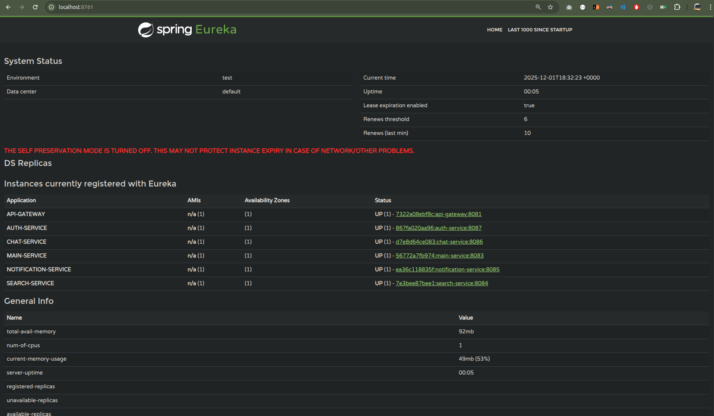
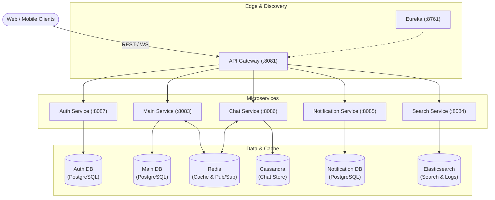
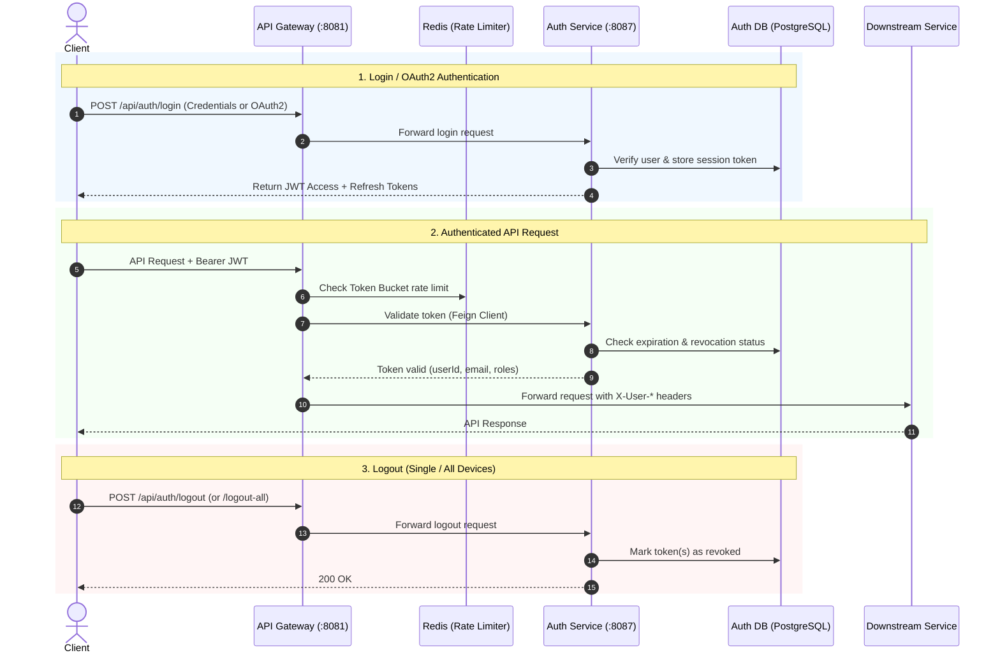
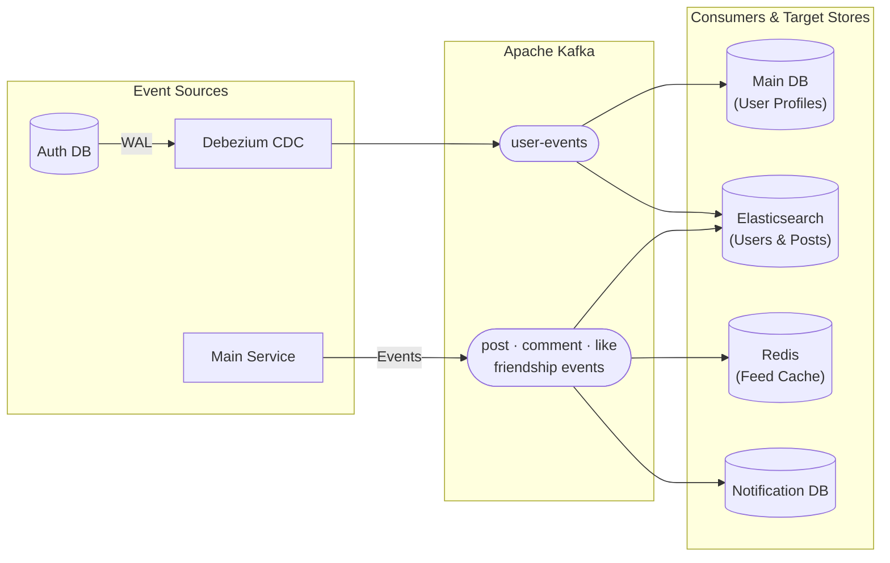
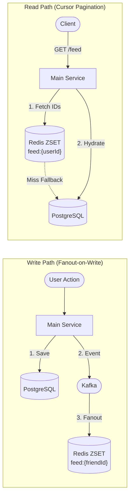
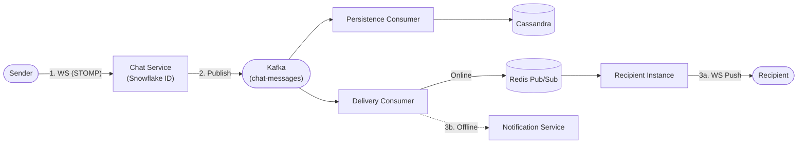
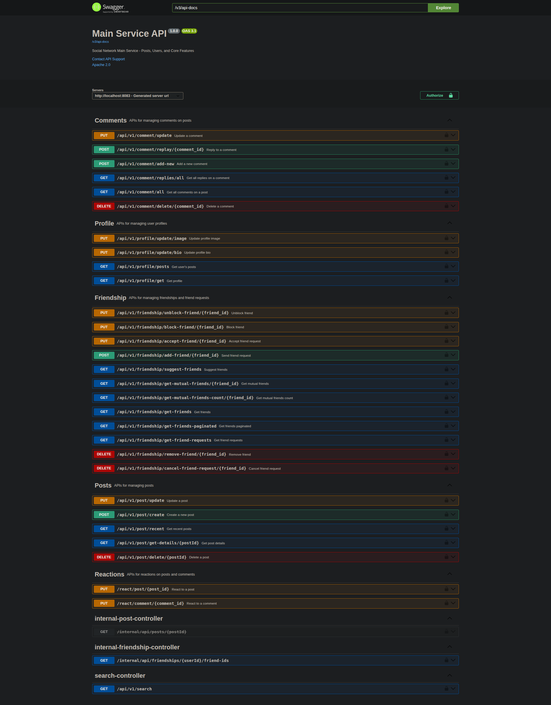
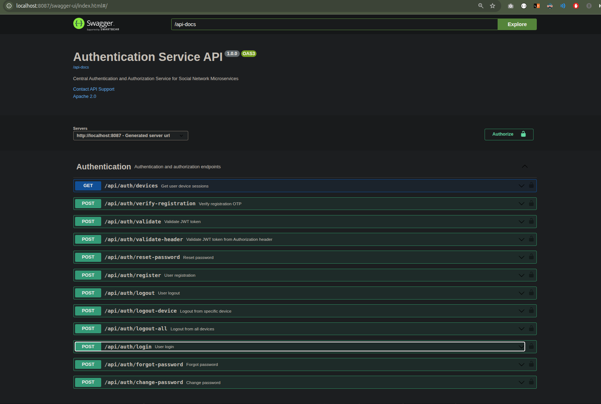
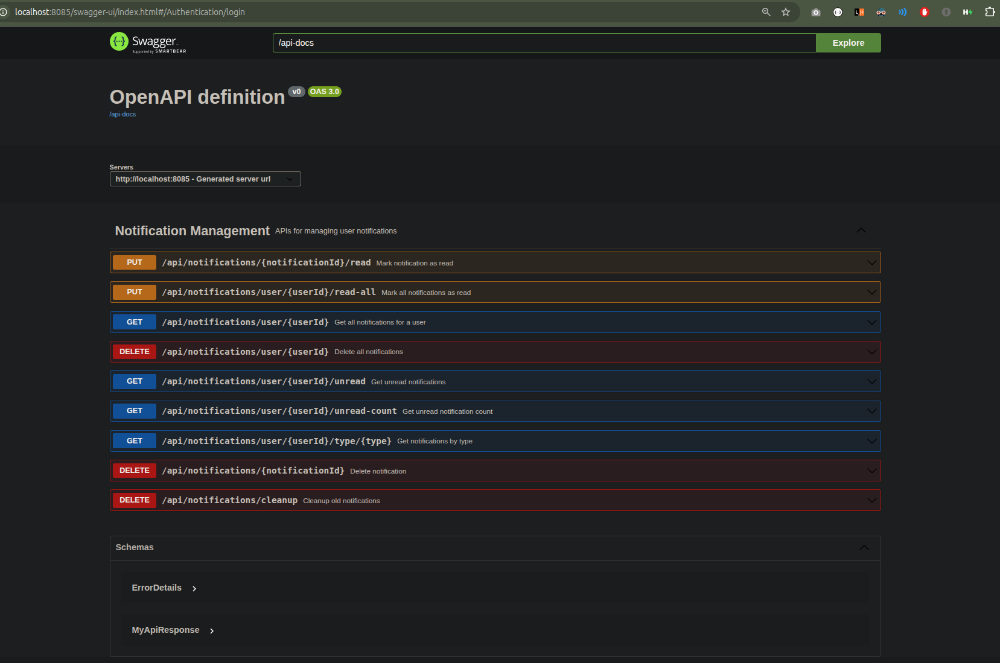
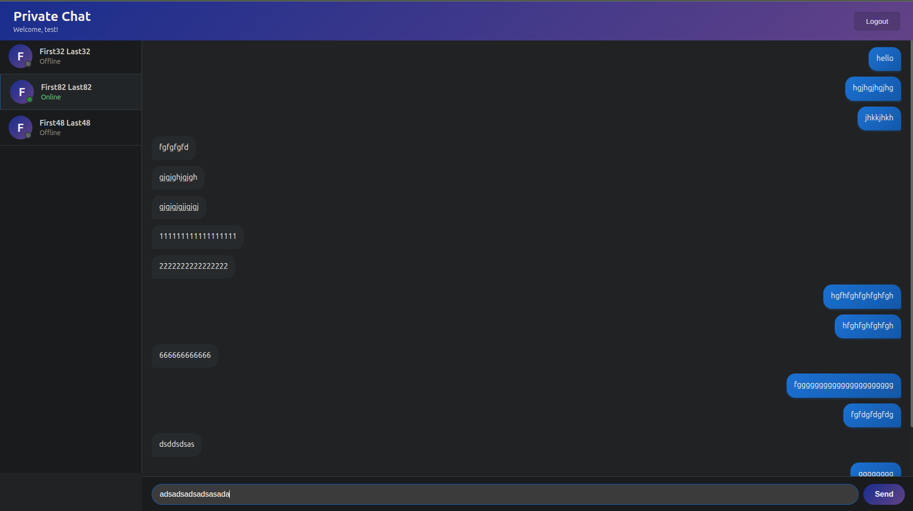

# Social Network Microservices Platform

A scalable microservice-based social network backend system built with Spring Boot, featuring event-driven architecture, real-time communication, and distributed data management. This platform demonstrates modern enterprise patterns including service discovery, API gateway routing, Change Data Capture (CDC), message-driven systems, and centralized observability.

**Development Status**: Production-ready microservices platform with complete infrastructure services. Active development continues on performance optimizations and advanced features.

**Last Updated**: April 2026

## Features

### Core Functionality
- User authentication and authorization with JWT token management
- **OAuth2 Social Login** (Google, Facebook, GitHub) with automatic user registration
- User profile management with support for bio, skills, and profile pictures
- Post creation and management with full CRUD operations
- Comment system with nested comment support and replies
- Friendship system including friend requests, mutual friends, and friend suggestions
- **Pre-computed News Feed** using a Fanout-on-Write Redis Sorted Set architecture
- Full-text search across users and posts powered by Elasticsearch
- Event-driven notification system using Apache Kafka
- Real-time chat functionality via WebSocket/STOMP with Snowflake IDs, Cassandra persistence, and heartbeat-based presence
- Multi-device session management and selective logout
- OTP verification system with email delivery
- Comprehensive API documentation via Swagger/OpenAPI
- Containerized deployment using Docker Compose

### Security & Infrastructure
- JWT-based stateless authentication with database-backed token revocation
- Centralized authentication service with Feign client integration
- Gateway-level and service-level security filters
- Role-based access control (RBAC) across all services
- **Token Bucket rate limiting** at the API Gateway (Redis-backed, per-route configurable)
- **Change Data Capture (CDC)** via Debezium + Kafka Connect on PostgreSQL WAL for zero-dual-write user identity propagation
- Centralized logging with ELK stack (Elasticsearch, Logstash, Kibana)
- Polyglot persistence architecture (PostgreSQL, Apache Cassandra, Elasticsearch, Redis)

### In Progress
- General-purpose Redis caching for user profiles and hot entities
- Enhanced monitoring and observability (ELK stack refinement, Prometheus/Grafana)
- Performance optimizations and CI/CD automation

---

## Architecture Overview

The system follows a microservices architecture pattern where each service owns its data and domain logic. Services communicate synchronously via REST/OpenFeign and asynchronously through Apache Kafka event streams.

### Service Topology

**Business Services**
- **Auth Service** (Port: `8087`) - Centralized authentication, OAuth2 social login, OTP, and JWT token management
- **Main Service** (Port: `8083`) - Core social graph: profiles, posts, comments, reactions, friendships, and Redis feed fanout
- **Chat Service** (Port: `8086`) - Real-time messaging via WebSocket/STOMP, Zookeeper Snowflake IDs, Cassandra persistence, and Redis Pub/Sub routing
- **Notification Service** (Port: `8085`) - Event-driven notification persistence and delivery consuming Kafka topics
- **Search Service** (Port: `8084`) - Full-text search powered by Elasticsearch with Kafka-based real-time indexing

**Infrastructure Services**
- **Gateway Service** (Port: `8081`) - API routing, load balancing, JWT authentication filtering, and Redis Token Bucket rate limiting
- **Discovery Service** (Port: `8761`) - Eureka service registry for dynamic service discovery

---

## Technology Stack

**Core Framework**
- Java 17, Spring Boot 3.x, Spring Cloud (Gateway, Netflix Eureka, OpenFeign), Spring Security with JWT & OAuth2

**Data Management**
- **PostgreSQL** - Primary relational database (isolated instances per service):
  - `auth-db`: User credentials, OAuth2 links, JWT tokens, revocation tracking
  - `main-db`: User profiles, posts, comments, friendships, reactions
  - `notification-db`: Notification history, read/unread status, delivery tracking
- **Apache Cassandra** - Distributed wide-column store for permanent chat message history (cursor-paginated via Snowflake IDs)
- **Elasticsearch** - Full-text search engine for user and post discovery
- **Redis** - News Feed sorted sets (`feed:{userId}`), API Gateway rate limiting, WebSocket presence tracking, and cross-instance Pub/Sub routing

**Communication & Messaging**
- **Apache Kafka & Zookeeper** - Event streaming, inter-service messaging, and Snowflake worker ID coordination
- **Debezium + Kafka Connect** - Change Data Capture (CDC) on PostgreSQL WAL for user identity propagation
- **WebSocket (STOMP/SockJS)** - Real-time bidirectional communication for chat
- **OpenFeign** - Declarative REST client for synchronous inter-service calls

**DevOps & Observability**
- Docker & Docker Compose, ELK Stack (Elasticsearch, Logstash, Kibana), Swagger/OpenAPI, Maven

---

## Service Details & Status

### Auth Service (Port: 8087)
**Status**: Production ready with OAuth2 social login
- Centralized authentication, registration, and JWT access/refresh token management
- Token revocation tracking in PostgreSQL with single-device and all-devices logout
- **OAuth2 Social Login** (Google tested; Facebook and GitHub configured) with custom success/failure handlers and automatic user provisioning
- OTP email verification and device fingerprinting for multi-device session management
- **CDC via Debezium**: User identity changes propagate automatically through PostgreSQL WAL — no dual-write, no outbox table
  - Postgres publication filters to `email_verified = true` — unverified rows never enter the event stream
  - Connector config: `services/auth-service/debezium/users-cdc-connector.json`
  - Sensitive columns (`password`, `oauth_provider`, `oauth_provider_id`) excluded at the connector level
- **TODO**: Migrate token storage to Redis for lower validation latency
- **TODO**: Add Redis-based session management
- **TODO**: Test and verify Facebook/GitHub OAuth2 integration in production
- **TODO**: Implement OAuth2 account linking (multiple providers per user)

### Main Service (Port: 8083)
**Status**: Fully functional
- User profile management (bio, skills, profile picture) and file upload handling
- Post CRUD operations, post reactions (like, love, etc.), nested comments, replies, and comment reactions
- Friendship system featuring friend requests, mutual friends, and friend suggestions
- **Pre-computed News Feed (Fanout-on-Write)**:
  - Domain events fire via `@TransactionalEventListener(AFTER_COMMIT)` to Kafka (`post-events`, `like-events`, `comment-events`, `friendship-events`)
  - Feed consumers push post IDs into each friend's Redis Sorted Set (`feed:{userId}`, capped at 500 entries)
  - `ZADD NX` on reactions/comments preserves original post chronology without bumping timestamps
  - $O(1)$ cursor-based pagination (`ZREVRANGEBYSCORE`) with automatic PostgreSQL CTE fallback and Redis backfill on cache misses
- **CDC-driven `UserProfile` sync**: `user_profiles` table is automatically populated from the `user-events` Kafka topic
  - Idempotent upsert with `auto-offset-reset: earliest` and exponential backoff retry (1s → 2s → 4s → 8s) routing exhausted failures to `user-events.DLT`
- **TODO**: Set up S3-compatible object storage (MinIO) instead of local filesystem uploads
- **TODO**: Create PostgreSQL indexes on foreign keys to optimize join performance
- **TODO**: Implement Redis caching for frequently accessed user data
- **TODO**: Implement soft deletes for posts and comments
- **TODO**: Add content moderation features (reporting, filtering) and user engagement analytics
- **TODO**: Integrate Prometheus & Grafana metrics and database migrations (Flyway/Liquibase)
- **TODO**: Add integration tests for critical workflows and CI/CD pipeline

### Chat Service (Port: 8086 — WebSocket)
**Status**: Phase 1 (foundation) complete — scalable redesign in progress
- WebSocket server with STOMP/SockJS and JWT authentication via HTTP-only cookies
- **Snowflake ID generation** per message (datacenter + machine + sequence bits), with worker IDs assigned via Zookeeper ephemeral sequential nodes
- **Kafka-based async message pipeline**: Messages published to `chat-messages` topic (partitioned by `conversationId` for strict per-conversation ordering)
- **Dual-write transition**: Kafka publish + Redis write-through during Phase 1 (Redis message list removed in Phase 3)
- **Cassandra persistence** (`messages_by_conversation` table) via dedicated Persistence Consumer with manual offset commit after successful writes
- **Cross-instance routing**: `userId → instanceId` mapped in Redis; Delivery Consumer routes frames via Redis Pub/Sub to the recipient's connected instance
- Heartbeat-based online presence (10s interval, 30s timeout) with periodic stale-session sweeping
- 1:1 private messaging with friendship validation
- **TODO**: Group chat (up to 100 members) with fan-out in Delivery Consumer
- **TODO**: Extract Presence Service as a standalone microservice
- **TODO**: Complete Phase 3 (remove Redis message dual-write)
- **TODO**: Add Swagger/OpenAPI documentation for REST history endpoints

### Search Service (Port: 8084)
**Status**: Integrated with Elasticsearch
- Full-text search across posts and user profiles
- Real-time Kafka consumers indexing post and user events into Elasticsearch
- **CDC-driven user index sync**: Consumes `user-events` via a dedicated container factory with idempotent document upserts (`_id = userId`), exponential backoff retry, and dead-letter topic (`user-events.DLT`)

### Notification Service (Port: 8085)
**Status**: Fully functional with PostgreSQL persistence
- Consumes Kafka domain events to generate and persist user notifications in PostgreSQL
- REST API for paginated retrieval (by user, type, read status) and marking notifications as read
- Indexed on `receiver_id`, read status, and timestamps, with scheduled cleanup of old read notifications
- **TODO**: Implement external delivery channels (email, mobile push notifications)
- **TODO**: Add real-time notification push over WebSocket
- **TODO**: Add user notification preferences, retry mechanisms, and rate limiting

### Discovery Service (Port: 8761 — Eureka)
**Status**: Fully functional
- Dynamic service registration, health monitoring, and heartbeat tracking for all microservices
- **TODO**: Advanced load balancing configuration and multi-zone deployment support



### Gateway Service (Port: 8081 — Spring Cloud Gateway)
**Status**: Fully functional
- Unified API entry point with Eureka-backed load balancing and centralized JWT authentication filter
- **Token Bucket rate limiting** (Redis-backed via `RedisRateLimiter`) with per-route configuration in `application.yml`:
  ```yaml
  gateway:
    rate-limiter:
      auth:    { rate: 5,  per: MINUTE, burst: 1  }   # brute-force protection (IP-keyed)
      general: { rate: 30, per: SECOND, burst: 60 }   # posts, notifications (User ID / IP fallback)
      search:  { rate: 15, per: SECOND, burst: 30 }
      chat:    { rate: 20, per: SECOND, burst: 40 }
  ```
- Returns `429 Too Many Requests` with `X-RateLimit-Remaining` headers
- **TODO**: Add circuit breaker patterns (Resilience4j) and enhanced request/response logging

### Centralized Logging (ELK Stack)
**Status**: Deployed via Docker
- Logstash collects structured logs from all microservices and indexes them into Elasticsearch for Kibana visualization
- **TODO**: Fine-tune log parsing, retention policies, alerting rules, and Prometheus/Grafana metrics integration

---

## Architecture & Data Flow Diagrams

### 1. High-Level System Architecture



### 2. Authentication & Request Flow



### 3. Event-Driven & CDC Data Flow

**Debezium CDC** streams verified user changes from `Auth DB` WAL, while `Main Service` publishes social domain events after database commits.



### 4. News Feed Data Flow (Write Fanout & Read Path)

Posts and activity fan out asynchronously to friends' Redis Sorted Sets (`feed:{userId}`), enabling $O(1)$ cursor-paginated reads with automatic PostgreSQL fallback on cache misses.



### 5. Real-Time Chat Data Flow

Messages are assigned globally ordered **Snowflake IDs** and published to Kafka (partitioned by `conversationId`) to decouple Cassandra persistence from real-time delivery.



---

## API Documentation

### Main Service API


### Auth Service API


### Notification Service API


### Chat Service Client


---

## Deployment & Project Structure

The platform uses Docker Compose (`docker/docker-compose-all.yml`) on a shared bridge network (`social_service_dev_network`) with multi-layer Dockerfiles that cache Maven dependencies independently per service.

- **Persistent Volumes**: `auth-db-data`, `main-db-data`, `notification-db-data` (PostgreSQL), `cassandra-data` (Cassandra), `kafka-data` (Kafka), `elasticsearch_data` & `kibana_data` (ELK), `main-service-uploads` (uploads)
- **System Requirements**: ~5.5 GB RAM, ~6 CPU cores (8 GB RAM recommended)

```plaintext
.
├── docker/
│   ├── docker-compose-all.yml          # Full platform orchestration (infra + services)
│   ├── docker-compose-kafka.yml        # Standalone Kafka + Zookeeper stack
│   └── elk-stack-docker/               # Elasticsearch, Logstash, Kibana config
├── shared/
│   └── security-lib/                   # Shared JWT authentication filter & Feign client
└── services/
    ├── auth-service/                   # Auth, OAuth2, OTP, Debezium CDC connector
    ├── chat-service/                   # WebSocket/STOMP chat, Snowflake IDs, Cassandra
    ├── discovery-service/              # Netflix Eureka Server
    ├── gateway-service/                # Spring Cloud Gateway & Redis rate limiter
    ├── main-service/                   # Posts, comments, friendships, Redis feed fanout
    ├── notification-service/           # Kafka notification consumer & REST API
    └── search-service/                 # Elasticsearch indexing & search API
```

---

## Getting Started

### Prerequisites
- Docker and Docker Compose (v20.10+)
- Java 17+ and Maven 3.6+ (for local development)
- Minimum 8 GB RAM for running all containers
- `.env` file in the project root (copy from `.env.examples`)

### Docker Deployment (Recommended)

```bash
# 1. Create .env file from template
cp .env.examples .env

# 2. Build and start all services
cd docker
docker-compose -f docker-compose-all.yml up -d

# 3. View logs or check container status
docker-compose -f docker-compose-all.yml logs -f
docker-compose -f docker-compose-all.yml ps

# 4. Rebuild a specific service after code changes (uses cached Maven layers)
docker-compose -f docker-compose-all.yml build <service-name>
docker-compose -f docker-compose-all.yml up -d <service-name>

# 5. Stop all services (add -v to remove volumes)
docker-compose -f docker-compose-all.yml down
```

### Local Development (Individual Services)

```bash
# Start infrastructure only
cd docker
docker-compose -f docker-compose-kafka.yml up -d
docker-compose -f elk-stack-docker/docker-compose-elk.yml up -d

# Install shared security library, then run any service locally
cd ../shared/security-lib && mvn clean install
cd ../../services/main-service && mvn spring-boot:run -Dspring-boot.run.arguments=--spring.profiles.active=dev
```

### Service Endpoints

**Microservices**
- **Gateway Service**: `http://localhost:8081` (Unified API routing & rate limiting)
- **Auth Service**: `http://localhost:8087` — [Swagger UI](http://localhost:8087/swagger-ui.html)
- **Main Service**: `http://localhost:8083` — [Swagger UI](http://localhost:8083/swagger-ui.html)
- **Search Service**: `http://localhost:8084` — [Swagger UI](http://localhost:8084/swagger-ui.html)
- **Notification Service**: `http://localhost:8085` — [Swagger UI](http://localhost:8085/swagger-ui.html)
- **Chat Service**: `http://localhost:8086` — WebSocket: `ws://localhost:8086/ws`
- **Discovery Service (Eureka)**: `http://localhost:8761`

**Infrastructure**
- **Kafka**: `localhost:29092` (host) / `kafka:9092` (container) — **Kafka UI**: `http://localhost:9093`
- **Elasticsearch**: `http://localhost:9200` — **Kibana**: `http://localhost:5601`
- **Redis**: `localhost:6379`
- **PostgreSQL DBs**: `localhost:5433` (auth), `5434` (main), `5435` (notification)

---

## Development Roadmap & Contributing

### Current Status
- **Production Ready**: JWT & OAuth2 authentication (Google, Facebook, GitHub), OTP verification, multi-device session management, posts/comments/friendships, Fanout-on-Write Redis News Feed, Debezium CDC user sync, real-time WebSocket chat with Cassandra & Snowflake IDs, Elasticsearch full-text search, Kafka notifications, Redis Token Bucket rate limiting, Eureka discovery, and Docker/ELK orchestration.
- **Planned / Open for Contribution**:
  - S3-compatible object storage (MinIO) for user media uploads
  - Group chat fan-out and standalone Presence microservice
  - Redis caching layer for hot entities and JWT validation
  - Real-time WebSocket/push notification delivery
  - Resilience4j circuit breakers, Prometheus/Grafana metrics, Flyway/Liquibase migrations, and CI/CD pipelines

Contributions, issues, and feature requests are welcome!

## License

This project is licensed under the MIT License.
